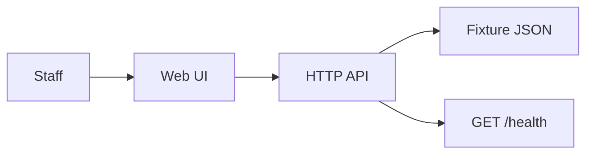
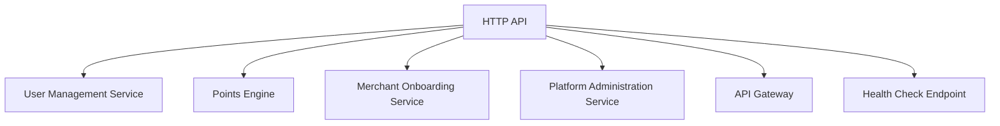
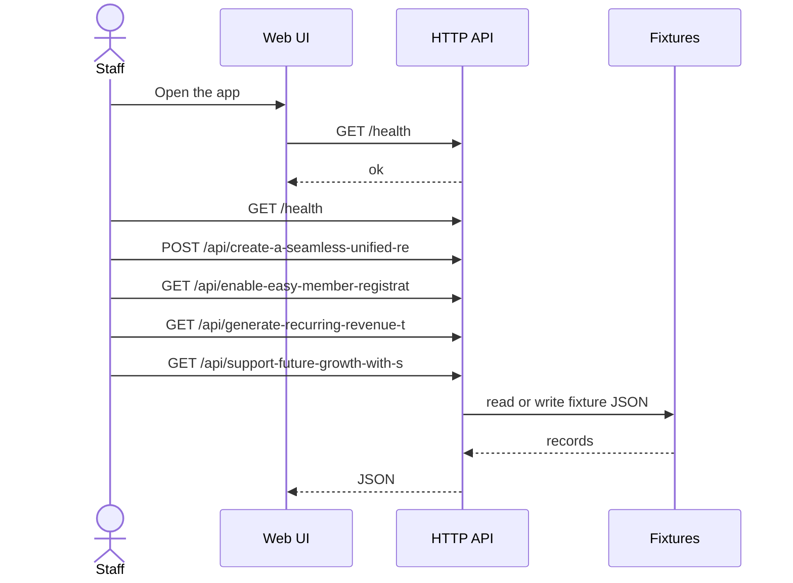

# PLAVAROY-1 — Plava Royalty Points System - Universal Rewards & Loyalty Application

## Intent
Problem
# BUSINESS PROPOSAL ## A Universal Rewards & Loyalty Application *Working Concept: One Membership.
Who it is for
Shop and stock teams
What version one does
Multiple Merchants.
In scope
Member registration, account management, and unique membership numbers
Points earning, calculation, notification, and redemption processes
Merchant onboarding, POS integration, and dashboard analytics
Platform administration including fraud detection and reporting
Out of scope
Developing individual loyalty programs for each merchant
Direct payment processing or financial transactions beyond points
Physical card issuance or non-digital rewards management
Custom merchant-specific loyalty features outside the unified system

This file is the approved architecture. Code is written from this document. Revise it until you approve.

## Ticket comments
- Sai: PLAVAROY-1 is architecture review. Live usage this call: 1193 tokens
- Sai: PLAVAROY-1 is code review. Project folder written at D:\Projects\VISUAL-DEVOPS-PLATFORM-V3\data\delivery-workspaces\2aK6USKwmjvx using Azure OpenAI. Open the workbench, then proceed for testing.
- Sai: PLAVAROY-1 is writing code. Now: calling Azure OpenAI to write the project files. This can take a minute.

## System context



## Components



- **User Management Service** (node) — Handles member registration, account management, and unique membership number assignment
- **Points Engine** (python) — Manages points earning, calculation, notification, and redemption processes
- **Merchant Onboarding Service** (node) — Manages merchant onboarding, POS integration, and dashboard analytics
- **Platform Administration Service** (python) — Handles fraud detection, reporting, and subscription management
- **API Gateway** (node) — Exposes RESTful APIs for all client and merchant interactions
- **Health Check Endpoint** (node) — Provides GET /health for system health monitoring
- **Fixture Data Module** (python) — Provides fixture data for testing and development
- **Fixture store** — JSON under `fixtures/`. No production database.

## APIs

| Method | Path | Purpose |
| --- | --- | --- |
| GET | `/health` | Deploy verify — report ok |
| POST | `/api/create-a-seamless-unified-re` | Create a seamless, unified rewards experience for customers and merchants |
| GET | `/api/enable-easy-member-registrat` | Enable easy member registration and secure transaction-based point allocation |
| GET | `/api/generate-recurring-revenue-t` | Generate recurring revenue through merchant subscriptions and transaction fees |
| GET | `/api/support-future-growth-with-s` | Support future growth with scalable cloud infrastructure and integrations |

## Request flow



## Technologies
- node
- python

After approval, this is implemented as a Node application. Allow-list: node, python. Packages: https://registry.npmjs.org, https://pypi.org. License: MIT.

## In scope
- Create a seamless, unified rewards experience for customers and merchants
- Enable easy member registration and secure transaction-based point allocation
- Generate recurring revenue through merchant subscriptions and transaction fees
- Support future growth with scalable cloud infrastructure and integrations

## Out of scope
- Production data access
- Work outside this ticket
- A pull request unless auto-open is enabled

## Assumptions
- The system will be deployed on a scalable cloud infrastructure.
- Authentication and authorization mechanisms will be implemented as part of the platform.
- POS integrations will follow standard protocols and APIs.
- Merchant subscriptions and transaction fees will be managed within the platform administration service.
- The application will comply with relevant data protection and privacy regulations.
- Testing includes unit, integration, and linting as per platform policy.
- No physical card issuance or non-digital rewards management is required.

## Deploy
After lint, unit, and integration, and after deploy approval, pick Git and a cloud, then run the pipeline. Target **dev**. Rollback owner: **Platform on-call**.

## Planner notes
## Architecture Overview

- **User Interface:** Web and mobile clients for members and merchants.
- **API Layer:** RESTful APIs for member registration, points management, merchant onboarding, and analytics.
- **Points Engine:** Service responsible for points calculation, earning, redemption, and notifications.
- **Merchant Integration:** POS connectors and onboarding workflows.
- **Platform Administration:** Fraud detection, reporting, and subscription management.
- **Data Storage:** Scalable cloud databases for member data, transactions, and analytics.
- **Security:** Authentication, authorization, and secure data handling.

## Platform Policy Components

- Fixture data for testing
- GET /health endpoint for health checks
- Linting for code quality
- Unit and integration tests

## Scalability & Future Growth

- Cloud-native architecture with microservices
- Support for multiple merchants and high transaction volumes
- Extensible integration points for future features

## Latest edits

The files below were saved in the workbench. They are the current version.

### src/app.js
operator saved this file. This is the current version.

```
import http from "node:http";
import fs from "node:fs";
import { fileURLToPath } from "node:url";
import path from "node:path";

const page = path.join(path.dirname(fileURLToPath(import.meta.url)), "../public/index.html");

export function health() {
  return { status: "ok" };
}

// New function to handle create unified rewards POST
export function createUnifiedRewards(data) {
  // For demo, just echo back the received data with an id
  return {
    id: "UR" + Date.now(),
    ...data,
    createdAt: new Date().toISOString(),
    message: "Unified rewards experience created successfully"
  };
}

// New functions to serve data for other GET API endpoints
export function getMemberRegistration() {
  return {
    description: "Enable easy member registration and secure transaction-based point allocation",
    members: [
      {
        memberId: "M1001",
        name: "Alice Johnson",
        email: "alice.johnson@example.com",
        membershipNumber: "PLAVA-0001",
        pointsBalance: 1200,
        registeredAt: "2024-05-20T10:15:30Z"
      },
      {
        memberId: "M1002",
        name: "Bob Smith",
        email: "bob.smith@example.com",
        membershipNumber: "PLAVA-0002",
        pointsBalance: 850,
        registeredAt: "2024-05-22T14:45:00Z"
      }
    ],
    secureTransactionPoints: true
  };
}

export function getRecurringRevenue() {
  return {
    description: "Generate recurring revenue through merchant subscriptions and transaction fees",
    merchants: [
      {
        merchantId: "MERCH1001",
        name: "SuperMart",
        subscriptionPlan: "Premium",
        subscriptionStatus: "active",
        monthlyFee: 99.99,
        transactionFeePercent: 1.5
      },
      {
        merchantId: "MERCH1002",
        name: "ElectroGoods",
        subscriptionPlan: "Standard",
        subscriptionStatus: "active",
        monthlyFee: 49.99,
        transactionFeePercent: 2.0
      }
    ]
  };
}

export function getFutureGrowthSupport() {
  return {
    description: "Support future growth with scalable cloud infrastructure and integrations",
    cloudInfrastructure: {
      provider: "Azure",
      services: ["Kubernetes", "CosmosDB", "Azure Functions"],
      scalability: "auto-scaling enabled",
      integrationPoints: ["REST APIs", "Webhook endpoints", "Event-driven architecture"]
    },
    status: "ready"
  };
}

export async function handle(req, res) {
  const pathName = new URL(req.url || "/", "http://localhost").pathname;

  if (req.method === "GET" && pathName === "/health") {
    res.writeHead(200, { "content-type": "application/json" });
    res.end(JSON.stringify(health()));
    return;
  }

  if (req.method === "GET" && (pathName === "/" || pathName === "/index.html")) {
    const html = fs.existsSync(page) ? fs.readFileSync(page, "utf8") : "<!doctype html><html><body></body></html>";
    res.writeHead(200, { "content-type": "text/html" });
    res.end(html);
    return;
  }

  if (req.method === "POST" && pathName === "/api/create-a-seamless-unified-re") {
    // Collect request body
    let body = "";
    for await (const chunk of req) {
      body += chunk;
    }
    try {
      const data = JSON.parse(body);
      const result = createUnifiedRewards(data);
      res.writeHead(200, { "content-type": "application/json" });
      res.end(JSON.stringify(result));
    } catch (err) {
      res.writeHead(400, { "content-type": "application/json" });
      res.end(JSON.stringify({ error: "Invalid JSON" }));
    }
    return;
  }

  // Fix GET endpoints for other API calls to return data
  if (req.method === "GET" && pathName === "/api/enable-easy-member-registrat") {
    res.writeHead(200, { "content-type": "application/json" });
    res.end(JSON.stringify(getMemberRegistration()));
    return;
  }

  if (req.method === "GET" && pathName === "/api/generate-recurring-revenue-t") {
    res.writeHead(200, { "content-type": "application/json" });
    res.end(JSON.stringify(getRecurringRevenue()));
    return;
  }

  if (req.method === "GET" && pathName === "/api/support-future-growth-with-s") {
    res.writeHead(200, { "content-type": "application/json" });
    res.end(JSON.stringify(getFutureGrowthSupport()));
    return;
  }

  res.writeHead(404, { "content-type": "application/json" });
  res.end(JSON.stringify({ error: "not found" }));
}

export function createServer() {
  return http.createServer(handle);
}

if (process.argv[1] && path.resolve(process.argv[1]) === fileURLToPath(import.meta.url)) {
  createServer().listen(Number(process.env.PORT || 3000));
}
```

### README.md
operator saved this file. This is the current version.

```
# Plava Royalty Points System - Universal Rewards & Loyalty Application

## Overview

Plava Royalty Points System is a unified rewards and loyalty platform designed to serve multiple merchants and their customers with a seamless membership experience. This application enables member registration, points earning and redemption, merchant onboarding, and platform administration including fraud detection and reporting.

## Features

- **Member Registration & Account Management:** Unique membership numbers and secure account handling.
- **Points Engine:** Earn, calculate, notify, and redeem loyalty points.
- **Merchant Onboarding:** POS integration and dashboard analytics for merchants.
- **Platform Administration:** Fraud detection, reporting, and subscription management.
- **Health Monitoring:** System health check endpoint.

## APIs

| Method | Path                                | Purpose                                                                 |
|--------|------------------------------------|-------------------------------------------------------------------------|
| GET    | `/health`                          | Verify deployment and report system health status                       |
| POST   | `/api/create-a-seamless-unified-re` | Create a seamless, unified rewards experience for customers and merchants |
| GET    | `/api/enable-easy-member-registrat` | Enable easy member registration and secure transaction-based point allocation |
| GET    | `/api/generate-recurring-revenue-t` | Generate recurring revenue through merchant subscriptions and transaction fees |
| GET    | `/api/support-future-growth-with-s` | Support future growth with scalable cloud infrastructure and integrations |

## System Context

The system consists of the following components:

- **User Management Service:** Handles member registration and account management.
- **Points Engine:** Manages points earning, calculation, notification, and redemption.
- **Merchant Onboarding Service:** Manages merchant onboarding, POS integration, and analytics.
- **Platform Administration Service:** Handles fraud detection, reporting, and subscription management.
- **API Gateway:** Exposes RESTful APIs for client and merchant interactions.
- **Health Check Endpoint:** Provides system health monitoring.
- **Fixture Data Module:** Provides fixture data for testing and development.

## Technologies

- Node.js for API Gateway, User Management, Merchant Onboarding, and Health Check.
- Python for Points Engine and Platform Administration services.
- JSON fixtures for test data.

## Deployment

The system is designed for deployment on scalable cloud infrastructure. After linting, unit, and integration testing, deploy to the **dev** environment. Rollback owner is the Platform on-call team.

## Assumptions

- Authentication and authorization are implemented within the platform.
- POS integrations follow standard protocols.
- Compliance with data protection and privacy regulations.
- Testing includes unit, integration, and linting.
- No physical card issuance or non-digital rewards management.
- **No separate database has been created for this application; data is currently served from in-memory fixtures and static JSON data.**

## License

MIT

---

For detailed architecture, API specifications, and development guidelines, refer to the approved architecture document `architecture.md`.
```

### test/integration.test.js
operator saved this file. This is the current version.

```
import test from "node:test";
import assert from "node:assert/strict";
import { createServer, handle, health } from "../src/app.js";

function invoke(method, url) {
  return new Promise((resolve) => {
    let status = 200;
    const req = { method, url, on(_event, cb) { if (_event === "end") cb(); return req; } };
    handle(req, {
      setHeader() {},
      writeHead(code) { status = code; },
      end(data) {
        let body = data;
        try { body = data ? JSON.parse(String(data)) : null; } catch { body = String(data ?? ""); }
        resolve({ status, body });
      },
    });
  });
}

test("health export and http health match", async () => {
  assert.equal(health().status, "ok");
  const res = await invoke("GET", "/health");
  assert.equal(res.status, 200);
  assert.equal(res.body.status, "ok");
  assert.ok(createServer());
});

test("root serves the website page", async () => {
  const res = await invoke("GET", "/");
  assert.equal(res.status, 200);
  assert.match(String(res.body), /<html/i);
  // The root path serves HTML, not JSON, so this test expects no JSON status object
  assert.doesNotMatch(String(res.body), /^\{"status":"ok"\}$/);
});

test("unknown path returns 404", async () => {
  const res = await invoke("GET", "/unknown-path");
  assert.equal(res.status, 404);
  assert.match(String(res.body), /not found/i);
});
```
